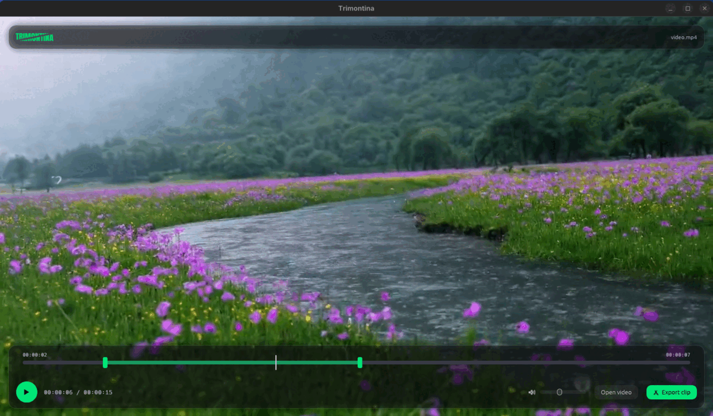

# Trimontina

Lossless video trimmer with a native preview and a modern interface.

Pick a range on the timeline and export it with `ffmpeg -c copy`: no
re-encoding, no quality loss, and an export that finishes almost instantly.



## How it works

The preview is **native rendering** not a webview, and not the window of an
external player:

```
libmpv (decodes) ──► our OpenGL texture ──► egui (draws it in the window)
```

libmpv is used as a **decoding library** through its *render API*. We create the
window and the OpenGL context; mpv only resolves the graphics function pointers
we hand it and writes the frame into a framebuffer we own.

That is what makes the behaviour **identical on Linux and Windows**, with no
`#[cfg(windows)]`/`#[cfg(unix)]` anywhere in the application code:

- there is no window embedding, so the historical Wayland problem does not exist;
- there is no webview, so we do not depend on WebKitGTK or GStreamer plugins;
- codecs come from mpv itself (which bundles ffmpeg), so MKV, AVI, MOV and
  friends work on both systems.

## Requirements

| | Linux | Windows |
|---|---|---|
| `libmpv` | the distribution's `mpv` package | `libmpv-2.dll` next to the executable |
| `ffmpeg` | on the `PATH` | `ffmpeg.exe` next to the executable, or on the `PATH` |

Both can be pointed at explicitly with the `MPV_PATH` and `FFMPEG_PATH`
environment variables.

## Building

### NixOS

```bash
nix-shell
cargo run --release
```

The `shell.nix` provides `libmpv`, `ffmpeg` and the OpenGL/windowing libraries,
and sets `LIBRARY_PATH` and `LD_LIBRARY_PATH`.

> Requires Rust **1.92+** (an `eframe`/`egui` 0.34 requirement). The shell
> deliberately does not pin a `rustc` version, so whichever one is installed is
> used.

### Other Linux distributions

Install the development dependencies and build:

```bash
# Debian/Ubuntu
sudo apt install libmpv-dev libgl1-mesa-dev libxkbcommon-dev \
                 libwayland-dev libx11-dev libxcursor-dev libxrandr-dev libxi-dev \
                 ffmpeg

cargo build --release
```

### Windows

1. Download an mpv build and copy `libmpv-2.dll` next to the executable.
2. Copy `ffmpeg.exe` to the same folder (optional if it is on the `PATH`).
3. `cargo build --release`

The Anton typeface used by the wordmark is embedded from `assets/fonts/` at
compile time, so nothing needs installing at runtime.

## Usage

```bash
trimontina                 # opens the file chooser
trimontina video.mp4       # opens the file directly
```

- **Click the video** to pause or resume playback.
- **Drag on the track** to move the playhead (seeks the video).
- **Drag the handles** to set the start and end of the clip.
- **Volume and mute** only change what you hear. The export copies the audio
  stream untouched, so they never affect the output file.
- **Export clip** writes the cut with a progress bar, then shows the result for
  three seconds before the button becomes available again.
- The interface floats over the video on translucent cards, and hides itself
  while playing; move the mouse to bring it back.
- Times are shown as `HH:MM:SS`.
- The wordmark splits along a diagonal on hover and is swept by a band while
  exporting.

### Two constraints of mpv's render API

Worth knowing, because they explain decisions that would otherwise look
arbitrary in the code:

1. **A stopped mpv decodes nothing.** If it never reaches playback, no frame is
   produced, nothing reaches the texture and the preview stays black. That is
   why the app starts playing instead of opening paused on the first frame.
2. **The embedder must draw at frame rate.** The render API hands frames over on
   demand; if we ask too rarely, mpv drops them. That is why the window is
   repainted continuously while playing.

## Code layout

```
src/
├── main.rs            entry point (eframe)
├── player/            media: libmpv as a decoding library
│   ├── mod.rs         Player — command facade
│   ├── surface.rs     VideoSurface — OpenGL texture + framebuffer
│   └── error.rs       PlayerError
├── app/               state and orchestration
│   ├── mod.rs         TrimontinaApp — wires player, state and UI
│   ├── state.rs       AppState — plain data, no framework types
│   └── selection.rs   Selection — the `start <= end` invariant
├── ui/                interface (egui)
│   ├── theme.rs       palette, card frames, bundled fonts
│   ├── title.rs       animated wordmark (sliced to fake a diagonal cut)
│   ├── preview.rs     video surface
│   ├── timeline.rs    track, handles and playhead
│   └── controls.rs    open / play / volume / export
└── video/             export
    ├── mod.rs         background execution
    └── ffmpeg.rs      lossless cut, with progress
```

Three principles drive the separation:

- **All `unsafe` and FFI live in `player/`.** The rest is ordinary Rust.
- **`app/state.rs` is plain data.** It knows nothing about egui, libmpv or I/O,
  which keeps it testable.
- **Seconds are the canonical unit.** Positions only become pixels while
  painting.

## Tests

```bash
nix-shell --command "cargo test"
```

They cover the `Selection` invariants, the `AppState` transitions (including
the export result clearing itself), the timeline geometry (which element a press
grabs, time formatting) and a real cut through `ffmpeg` (using
`testdata/sample.mp4`).

## Design notes

See [`DESIGN.md`](DESIGN.md) for the architecture and the reasoning behind each
significant decision.
